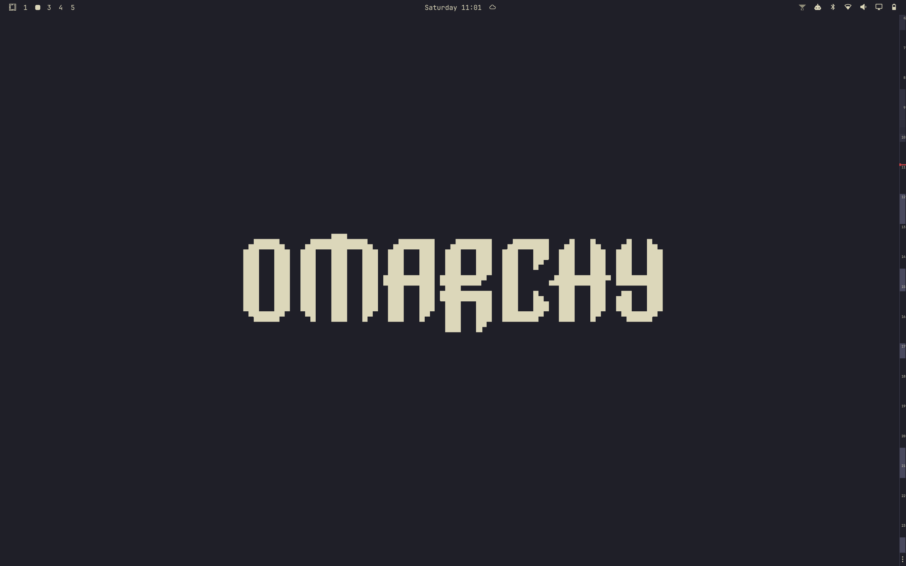
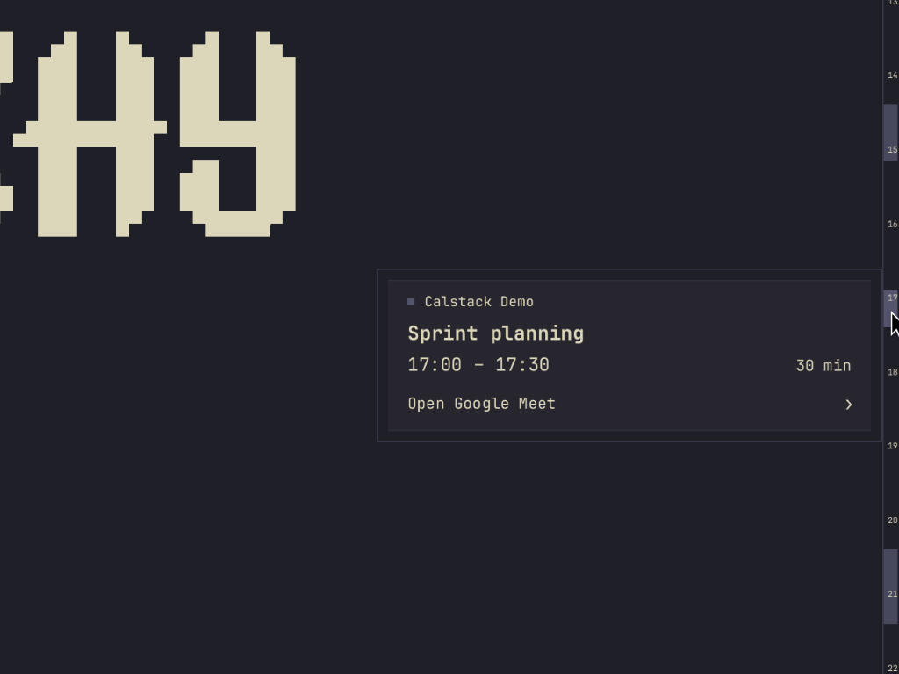

# CalStack

A minimalist thin vertical calendar for Mac and Linux





A thin, always-visible calendar strip for Wayland and macOS. Today's events
sit on the right edge of your screen as a 13-pixel timeline, so you can see
your day at a glance and join meetings in one click. No browser engine, no
continuous render loop.

## What it does

### Today at the edge of your screen

- The strip runs top to bottom from `day_start` to `day_end` (06:00–24:00 by
  default). Each event is a block whose height matches its length.
- Events that already ended fade out, the current one is drawn brightest, and
  a marker shows the current time.
- Overlapping events share one block; hover it to see them all. Each calendar
  can have its own color.
- On Linux the strip reserves its own space, so windows don't cover it. On
  macOS it floats above other windows.

### Hover and click

| Do this | And CalStack |
| --- | --- |
| Hover an event | Shows its title, time, and calendar in a popup |
| Hover overlapping events | Lists every event in that slot |
| Click an event with a meeting link | Opens the meeting (Google Meet, Zoom, Teams, Webex, Whereby, Jitsi, Chime, GoTo) |
| Click an event without a link | Opens a popup with the full details |
| Click `⋮` at the bottom | Opens the Refresh / Settings / Quit menu |

### Meeting reminders

A desktop notification arrives shortly before each meeting that has a link
(2 minutes by default). Click it to join. You can change the lead time or
turn reminders off in Settings.

### Auto-hide (optional)

Like the macOS Dock: the strip tucks away to a one-pixel sliver on the right
edge. Rest the pointer there for half a second and it slides out. Once the
pointer leaves the strip and any popup, it slides back. Turn it on in
Settings with **Auto-hide at the screen edge**. It's off by default.

### Calendars

- Subscribe to any ICS feed: Google Calendar, Outlook, iCloud, or anything
  with a private ICS / `webcal://` link. Local `.ics` files work too.
- Recurring events, exceptions, cancellations, and time zones are handled.
  See [what's supported](docs/configuration.md#supported-ics).
- Events you declined are hidden automatically. All-day events aren't shown.
- Feeds refresh in the background (every 10 minutes by default) and are cached,
  so the strip still shows your day offline.

### Fits your desktop

- **Linux:** works with layer-shell compositors such as Hyprland and Sway.
  On Omarchy it picks up your theme's colors and fonts live, with no plugin
  needed.
- **macOS:** follows the system light/dark appearance and stays visible
  across Spaces and fullscreen apps. See the
  [macOS notes](docs/configuration.md#macos).
- Native settings window, changes apply within seconds, and optional
  **Start at login**.

## Install

Any Linux distro (prebuilt binary):

```sh
curl --proto '=https' --tlsv1.2 -LsSf \
  https://github.com/reustle/calstack/releases/latest/download/calstack-installer.sh | sh
```

Arch / Omarchy (AUR):

```sh
yay -S calstack        # build from source
yay -S calstack-bin    # prebuilt
```

From source, with Rust and the [runtime dependencies](docs/install.md):

```sh
make install PREFIX="$HOME/.local"
~/.local/bin/calstack --settings
~/.local/bin/calstack
```

macOS, from source:

```sh
make install-macos     # builds CalStack.app and copies it to /Applications
```

`make bundle-macos` builds the app into `dist/` without installing it, and
`make uninstall-macos` removes it. The app isn't notarized, so the first launch
needs right-click → **Open** (or System Settings → Privacy & Security →
**Open Anyway**).

## Getting started

1. Launch CalStack. The strip appears on the right edge of your screen.
2. Click `⋮` at the bottom of the strip, choose **Settings…**, and add your
   calendar's ICS link.
3. Save. Your events appear within a few seconds.

To try it without a calendar, run `calstack --demo`.

## More

- [Install, autostart & uninstall](docs/install.md)
- [Configuration & calendar support](docs/configuration.md)
- [Development & verification](docs/development.md)
- [Build plan](PLAN.md)

MIT licensed.
